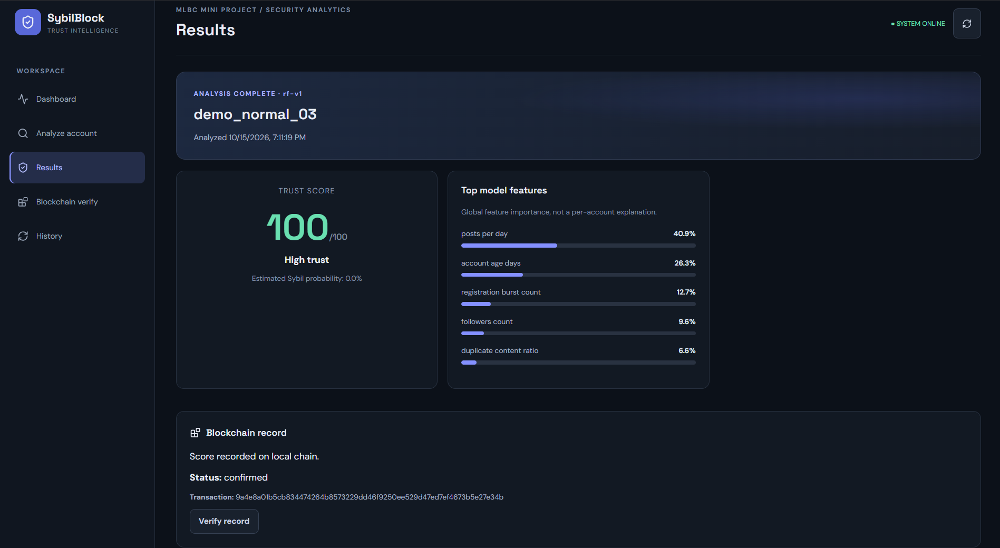
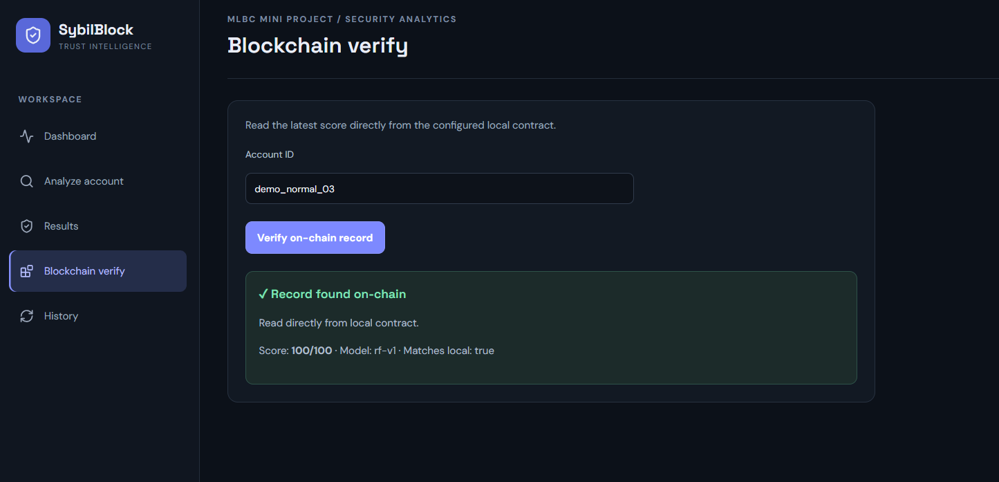

# SybilBlock — local prototype

## Stack
React + Vite, FastAPI, scikit-learn Random Forest, SQLite, Solidity + Hardhat.

## Screenshots

### Dashboard


### Analysis Results


### Blockchain Verification


## System Architecture

flowchart TD
    A[User] --> B[React Frontend]
    B --> C[FastAPI Backend]
    C --> D[Input Validation]
    D --> E[Trained ML Model]
    E --> F[Sybil Probability]
    F --> G[Trust Score and Risk Category]
    G --> H[(SQLite Database)]
    G --> I[Solidity Smart Contract]
    I --> J[Local Hardhat Blockchain]
    J --> K[Blockchain Verification]
    K --> B
    H --> B


## Project Workflow

flowchart TD
    A([Start]) --> B[Enter Account Features]
    B --> C[Validate Input]
    C --> D[ML Model Predicts Sybil Probability]
    D --> E[Calculate Trust Score]
    E --> F[Assign Risk Category]
    F --> G[Save Analysis to SQLite]
    G --> H{Blockchain Enabled?}
    H -- Yes --> I[Submit Score to Smart Contract]
    I --> J[Store Transaction Status]
    H -- No --> K[Mark Blockchain as Demo Only]
    J --> L[Display Results]
    K --> L
    L --> M[Verify On-Chain Record]
    M --> N([End])


## Run backend
Python 3.10+ recommended.
```bash
cd backend
python -m venv .venv
# Windows: .venv\Scripts\activate
.venv/Scripts/activate
pip install -r requirements.txt
python train_model.py
uvicorn app.main:app --reload
```
API docs: http://127.0.0.1:8000/docs

## Run frontend (new terminal)
```bash
cd frontend
npm install
npm run dev
```
Open http://127.0.0.1:5173

## Optional real local blockchain
```bash
cd blockchain
npm install
npx hardhat compile
npx hardhat node
```
In another terminal:
```bash
cd blockchain
npx hardhat run scripts/deploy.js --network localhost
```
Copy deployed address into `backend/.env` and set:
```env.example to env and configure it 
BLOCKCHAIN_ENABLED=true
RPC_URL=http://127.0.0.1:8545
CONTRACT_ADDRESS=0xYOUR_DEPLOYED_CONTRACT
PRIVATE_KEY=PASTE_LOCAL_HARDHAT_ACCOUNT_KEY
```
Restart FastAPI. Use only a local Hardhat development key, never a real wallet key.

Without blockchain enabled, ML scoring and history still work and the app says `demo-only`. Synthetic data is for demonstration and is not proof of real-world accuracy.
